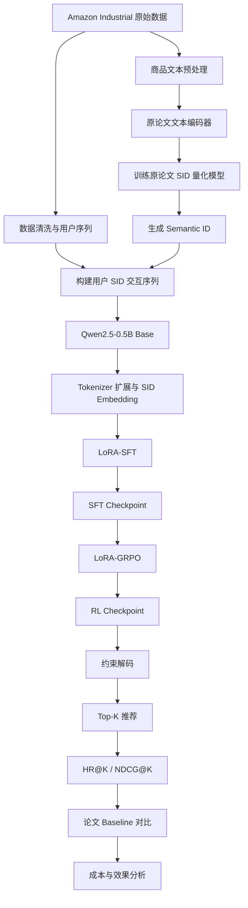

# MiniOneRec-Lite：低成本生成式推荐系统端到端复现任务书

## 0. 你的角色与工作方式

你是一名具有大语言模型训练、推荐系统、PyTorch、Transformers、PEFT、GRPO 和工程复现经验的高级算法工程师。

请作为本项目的主要开发 Agent，负责从论文与源码分析、环境配置、数据准备、代码实现、测试验证，到后续 GPU 训练、评估和实验报告的完整工作。

**重要：你必须自主推进所有不需要付费 GPU 的准备工作，但在需要租用服务器、启动正式 GPU 训练之前必须停止，等待我明确授权。**

不要只给出操作建议。对于能够在当前环境完成的工作，请直接修改代码、创建文件、执行测试并记录结果。

遇到错误时，优先自行定位、修复和重新测试。只有遇到需要用户授权、无法获取的资源或重要技术决策时才向我提问。

## 1. 项目目标

项目名称：MiniOneRec-Lite

项目定位：基于 Qwen2.5-0.5B Base 的 MiniOneRec 低成本端到端复现。

核心目标：

从原始数据开始，完整复现 MiniOneRec 的商品语义编码、Semantic ID 构建、SFT、GRPO、约束解码和推荐评估流程。

在保留原论文核心算法的前提下，通过小模型和 LoRA 降低训练资源需求，并衡量低成本复现的推荐效果与计算成本。

最终回答：

1. 完整复现 MiniOneRec 需要多少 GPU-hours？
2. 实际产生多少计算费用？
3. 我们的 HR@10、NDCG@10 分别是多少？
4. 达到了原论文 MiniOneRec 多少比例的效果？
5. 与原论文报告的推荐 Baseline 相比表现如何？

## 2. 项目范围与限制

### 必须完成

- 从原始 Amazon Industrial 数据开始处理。
- 按照原论文方法提取商品语义向量。
- 独立训练原论文使用的 SID 量化模型。
- 为商品生成 Semantic ID。
- 构建用户历史行为与目标商品的训练数据。
- 使用 Qwen2.5-0.5B Base。
- 使用 LoRA 完成 SFT。
- 使用 LoRA 完成 GRPO。
- 保留原论文 GRPO 奖励函数与采样方法。
- 保留原论文约束解码和推荐评估协议。
- 记录所有阶段的计算资源消耗。
- 对比原论文 MiniOneRec 及其报告的 Baseline。

### 明确不做

- 不更换其他 Qwen 基座。
- 不设计新的推荐模型。
- 不修改原论文奖励函数。
- 不新增算法创新。
- 不进行 Batch Size、LoRA Rank 等参数消融。
- 不重新训练原论文的其他 Baseline。
- 不为了获得更好结果而改变测试集或评估口径。
- 不将论文报告结果表述为自己复现的结果。

允许为降低计算成本调整模型规模、微调方式、Micro Batch Size、梯度累积和必要的工程配置，但必须记录所有与原论文不同的设置。

## 3. 官方资料

论文：MiniOneRec，arXiv:2510.24431

官方仓库：
https://github.com/AkaliKong/MiniOneRec

基座模型：
https://huggingface.co/Qwen/Qwen2.5-0.5B

开始工作时，请先阅读原论文、官方 README、数据处理代码、SID 量化代码、SFT 训练代码、GRPO 训练代码、约束解码代码和评估代码。

必须以实际论文和源码为准，不要凭经验猜测训练参数。

若论文、README 与代码之间存在差异，请明确列出差异及最终采用的依据。

## 4. 项目技术架构



要求实际代码实现与上述流程一致。

SID 量化算法、商品 ID 映射、训练样本构建和 GRPO 细节必须根据原论文与官方实现确定，不允许自行替换成其他方法。

## 5. Baseline 与评估

主要效果参考：原论文 MiniOneRec。

其他参考 Baseline：

- GRU4Rec
- Caser
- SASRec
- HSTU
- TIGER
- LC-Rec
- BIGRec
- D3
- S-DPO

请核实这些模型在原论文中的准确名称、数据集、指标与结果。

只引用原论文报告值，不重新训练上述模型。

统一使用 Amazon Industrial 数据集，并尽可能保持原论文的数据切分、评估候选集合、约束解码及 Top-K 计算方式。

主要指标：

- HR@5、HR@10
- NDCG@5、NDCG@10

效果保留率：

Performance Retention = Lite NDCG@10 / Paper NDCG@10 × 100%

必须注明跨实验比较的配置差异，不得把不同实验条件下的指标视为严格受控的比较。

## 6. 计算成本统计

完整统计以下阶段：

1. 商品文本语义编码。
2. SID 量化模型训练及 SID 生成。
3. SFT 训练。
4. GRPO 训练。
5. 推荐推理和评估。

每个阶段记录：

- GPU 型号与数量。
- GPU-hours。
- 实际运行时间。
- 峰值显存。
- 训练数据量。
- 主要训练配置。
- 实际云服务器费用。

GPU-hours = GPU 数量 × 实际占用小时数。

如果不同阶段使用不同型号 GPU，必须分别报告，不能直接将 GPU-hours 视为等价计算量。

若原论文没有公开完整 GPU-hours，不允许编造原论文训练成本，也不能声称精确节省了某个百分比。

## 7. 项目目录规划

建议使用以下结构，可根据官方仓库实际情况合理调整。

```text
MiniOneRec-Lite/
├── README.md
├── pyproject.toml
├── uv.lock
├── configs/
│   ├── data.yaml
│   ├── sid.yaml
│   ├── sft_lora.yaml
│   └── grpo_lora.yaml
├── data/
│   ├── raw/
│   ├── processed/
│   └── sid/
├── src/
│   ├── data/
│   ├── semantic_id/
│   ├── models/
│   ├── trainers/
│   ├── inference/
│   └── evaluation/
├── scripts/
│   ├── prepare_data.sh
│   ├── build_sid.sh
│   ├── train_sft.sh
│   ├── train_grpo.sh
│   └── evaluate.sh
├── tests/
├── outputs/
│   ├── checkpoints/
│   ├── logs/
│   └── results/
└── docs/
    ├── requirements.md
    ├── architecture.md
    ├── experiment_plan.md
    ├── original_config.md
    ├── resource_estimation.md
    └── reproduction_report.md
```

优先复用官方实现，不要为了目录美观而重写已经正确运行的核心训练器。

## 8. 第一阶段：租用 GPU 之前的工作

此阶段立即开始，无需等待我逐步确认。

### Task 1：论文与源码分析

阅读论文及官方仓库，整理：

- 整体模型结构。
- 原始数据集及预处理。
- 文本编码器及 SID 量化方法。
- SID 编码规则与冲突处理。
- SFT 训练目标与配置。
- GRPO 奖励、采样、优势计算和损失。
- 约束解码实现。
- 评估协议。
- 原论文所有 Baseline 结果。

生成 `docs/original_config.md`。

对于无法确认的参数，标记为“待核实”，不能编造。

### Task 2：建立项目环境

检查当前 Python、PyTorch、Transformers、PEFT、TRL、CUDA 或 MPS 环境。

优先使用 uv 管理依赖。

尽可能复用官方代码，建立可复现的依赖配置。

区分本地开发依赖和 NVIDIA GPU 训练依赖。

### Task 3：数据准备

获取官方指定的 Amazon Industrial 原始数据。

按论文方法实现数据预处理、数据划分、用户行为序列构建。

如果下载体积较大，先确认本地存储容量，必要时仅下载小样本用于测试，并将正式数据处理留到 GPU 服务器阶段。

禁止把正式测试集用于训练。

### Task 4：SID 模块准备

阅读并复用官方 SID 生成实现。

准备商品文本编码、量化模型训练、SID 生成和映射检查代码。

通过小规模合成数据或真实小样本验证：

- 输入输出维度正确。
- SID 编码格式正确。
- 商品映射可追踪。
- 冲突处理符合原论文。

正式大规模 SID 生成可以留到 GPU 阶段。

### Task 5：Qwen 与 LoRA 适配

使用 Qwen2.5-0.5B Base。

实现或适配：

- 模型加载。
- SID Tokenizer 扩展。
- 新增 SID Token 的 embedding 训练。
- LoRA 配置。
- SFT 模型保存与加载。
- GRPO 阶段 adapter 加载。
- 参考模型与训练模型的参数管理。

特别检查新增 SID Token 在 LoRA 模式下是否真正参与训练，并且能在重新加载 checkpoint 后保持一致。

### Task 6：训练与评估脚本

准备 SFT、GRPO、约束解码和评估的运行入口。

使用极小样本进行 Smoke Test，验证：

- SFT 能完成前向和反向传播。
- LoRA 参数能够更新。
- GRPO 奖励与优势计算正确。
- 推荐结果能够映射到合法商品。
- HR 和 NDCG 计算正确。
- Checkpoint 可以保存并重新加载。

Smoke Test 不要求得到有意义的推荐效果。

### Task 7：GPU 资源估算

根据实际代码、模型规模、序列长度、GRPO 候选组大小和 LoRA 配置，估算：

- 最低可行显存。
- 推荐 GPU 型号。
- 是否可以单卡运行。
- 各阶段预计耗时。
- 预计 GPU-hours。
- 云服务器费用范围。

这些均应标注为估计值，正式训练后使用实测数据替换。

## 9. 强制暂停节点：等待用户租用服务器

完成第一阶段后，必须停止执行。

不得自行：

- 购买或租用 GPU。
- 启动付费云服务器。
- 提交正式训练任务。
- 使用未经授权的付费 API 或计算资源。
- 将本地小样本测试视为正式实验。

此时向我输出：

**“MiniOneRec-Lite 的本地准备阶段已经完成。现在需要租用 GPU 服务器才能继续正式实验。”**

同时提供：

1. 已完成任务清单。
2. 当前测试通过情况。
3. 推荐 GPU 型号、显存及数量。
4. 预计服务器租用时间和费用。
5. 服务器需要安装的环境。
6. 租好服务器后需要我提供的 SSH 连接信息或其他必要信息。
7. 尚未解决的风险与问题。

然后停止，等待我的回复。

只有当我明确表示服务器已经准备好、允许开始正式实验后，才进入下一阶段。

## 10. 第二阶段：服务器准备好后继续

获得我的明确授权后，依次执行：

### Step 1：服务器环境验证

检查 NVIDIA GPU、CUDA、驱动、PyTorch、显存及依赖兼容性。

### Step 2：完整 SID 构建

处理完整商品数据，提取语义向量，训练原论文量化模型，生成 SID，保存映射和检查报告。

### Step 3：LoRA-SFT

使用 Qwen2.5-0.5B Base 完成正式监督微调。

保存训练配置、日志、Checkpoint 和评估结果。

### Step 4：LoRA-GRPO

从 SFT Checkpoint 继续训练，保留原论文奖励函数与训练逻辑。

记录 Reward、KL、训练损失、显存和耗时。

### Step 5：推荐评估

按照原论文评估协议运行约束解码，生成 Top-K 推荐，计算 HR@K、NDCG@K。

### Step 6：论文结果对比

整理原论文 MiniOneRec 和其他 Baseline 的报告值。

加入我们的实际实验结果，并计算效果保留率。

### Step 7：成本分析

汇总全部阶段的 GPU-hours、峰值显存、实际费用和最终推荐效果。

### Step 8：最终报告

生成 `docs/reproduction_report.md`，至少包含：

- 项目背景与复现目标。
- 原论文方法。
- 我们的低成本配置。
- 实验环境与数据集。
- 训练过程。
- 推荐效果对比。
- 计算成本统计。
- 论文效果保留率。
- 复现偏差与局限。
- 项目结论。

## 11. 工作质量要求

所有实验必须真实运行。

不得伪造训练日志、实验结果、GPU 消耗或费用。

不得将估计结果当作实测结果。

不得擅自更改核心算法来提升指标。

不得擅自扩大实验范围。

代码必须可以复现，并保留必要注释、运行说明和配置。

遇到问题时优先定位根因，不要通过删除评估、绕过训练或修改测试数据来让流程表面上通过。

## 12. 现在立即开始

请先检查当前工作目录、已有项目文件、官方论文和官方 GitHub 仓库。

然后：

1. 完成原论文与官方代码分析。
2. 确定完整复现的技术路径。
3. 建立项目结构。
4. 实现所有不需要正式 GPU 训练的准备工作。
5. 执行本地测试。
6. 生成 GPU 资源建议。

不要停留在规划层面，直接开展可以执行的工作。

**当且仅当项目进入需要租用服务器进行正式实验的阶段时，停止并通知我，等待我完成服务器租用。**