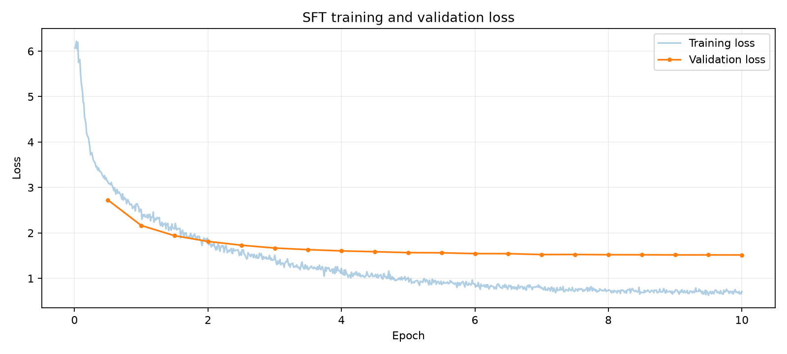
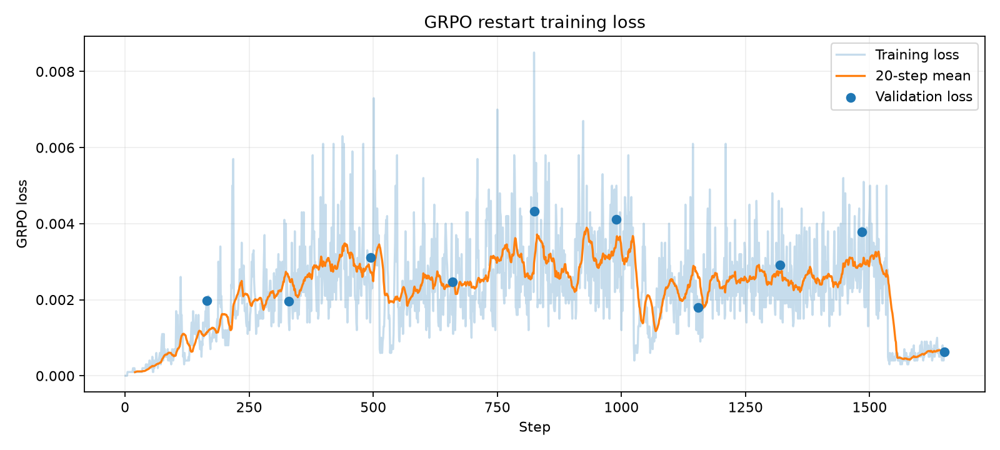

# MiniOneRec-Qwen2.5-0.5B

面向 Amazon Industrial 的 MiniOneRec 低成本端到端复现：Qwen3-Embedding-4B 商品编码、RQ-VAE Semantic ID、Qwen2.5-0.5B Base LoRA-SFT / GRPO、约束解码与推荐评测。基于 [MiniOneRec 论文](https://arxiv.org/abs/2510.24431) 和 [官方实现](https://github.com/AkaliKong/MiniOneRec)；本项目为复现及工程适配，不是官方发布版本。

## 实验结果

| Amazon Industrial | HR@5 | NDCG@5 | HR@10 | NDCG@10 |
| --- | ---: | ---: | ---: | ---: |
| 本项目 SFT | 0.10986 | 0.08749 | 0.13898 | 0.09684 |
| 本项目 GRPO | 0.10765 | 0.08434 | 0.13677 | 0.09374 |
| 论文 MiniOneRec | 0.1321 | 0.1084 | 0.1586 | 0.1167 |
| 论文 TIGER | 0.1010 | 0.0807 | 0.1321 | 0.0908 |
| 论文 BIGRec | 0.1092 | 0.0907 | 0.1370 | 0.0997 |
| 论文 S-DPO | 0.1238 | 0.0991 | 0.1524 | 0.1082 |

论文数值为引用，不是本项目重训。GRPO NDCG@10 / 论文 MiniOneRec NDCG@10 = **80.33%**；模型大小、Base/Instruct、LoRA、SID 碰撞等条件不同，非严格受控对比。SFT 与 GRPO 使用相同测试协议，GRPO NDCG@10 相对 SFT 下降约 3.20%；单次运行不代表统计显著性。更多论文 benchmark 及协议差异见 [论文和源码配置](docs/original_config.md)。

## 资源与时间

单张 PPU-ZW810（96 GiB），成功主路径约 **29.94 PPU-hours**，包含已记录失败及中断尝试和 SFT 对照测试约 **40.51 PPU-hours**，未计入部分准备和模型合并。SFT 11.64、最终 GRPO 16.91 PPU-hours；峰值设备显存分别采样为 12,620、27,348 MiB。PPU-hours 是进程墙钟×设备数，而非 GPU 利用率积分。

**无法计算相对论文总资源和总耗时百分比**：论文未给出可核实的对应完整卡时和端到端耗时，且设备型号不同。不能将设备数量之比当作算力或耗时之比。实际收费不统计。

## 流程与数据

`原始数据 → 商品文本编码 → RQ-VAE → SID → Qwen2.5 LoRA-SFT → LoRA-GRPO → 约束 beam search → HR/NDCG`

训练 / 验证 / 测试原始序列为 36,259 / 4,532 / 4,533；7,694 用户、3,686 商品。3,675 个唯一 SID，残余碰撞约 0.2984%，指标采用官方 SID 等价口径。每条测试生成 50 个候选，两组模型的独立审计均为非法与重复候选 0。完整测试集未用于训练；商品目录及元数据用于 SID 和约束构建。




GRPO loss 包含 KL 惩罚，且参考模型定期同步，不能单凭 loss 判定推荐效果。原始 GRPO 在第一轮后中止，最终从 SFT 权重重新初始化 LoRA，beta 0.005、学习率 5e-6、组大小 16、裁剪 0.3、2 epoch。有关非有限梯度排查及配置差异见 [复现报告](docs/reproduction_report.md) 和 [讲解说明](docs/实验讲解说明书.md)。

## 代码结构

```text
upstream/       官方固定版本代码及 Lite 适配（含上游许可证）
scripts/        数据、SID、训练、评估及审计入口
docs/           论文差异、实验报告、资源、验证与训练曲线
results/        SFT / GRPO 汇总指标和独立审计结果
PROJECT_PROMPT.md  原始任务书
pyproject.toml, uv.lock  本地及 NVIDIA 环境依赖
```

## 运行与复核

```bash
uv sync --locked
scripts/smoke_training.sh
scripts/download_industrial.sh
scripts/pipeline.sh prepare
# 授权 GPU 后依次运行 embed、quantize、index、convert、sft
FORMAL_GPU_AUTHORIZED=1 scripts/restart-grpo.sh
FORMAL_GPU_AUTHORIZED=1 scripts/evaluate-sft.sh
```

详细路径、index 参数和 GPU 授权见 [脚本](scripts/pipeline.sh)。仓库锁文件针对 Python 3.11 / NVIDIA CUDA；实际实验使用 Python 3.12 和厂商 PPU 环境，见 [依赖记录](docs/server-pip-freeze.txt)，包含不可移植的厂商 wheel 路径。模型权重、原始数据、逐样本预测及用户交互不包含在仓库中；本地归档提供后可运行 `scripts/audit_saved_results.sh`。训练日志、权重与完整结果的使用须遵守相应数据、模型及代码许可证。
