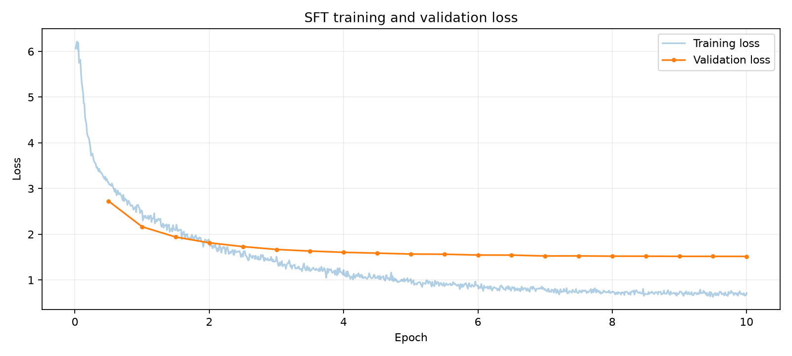
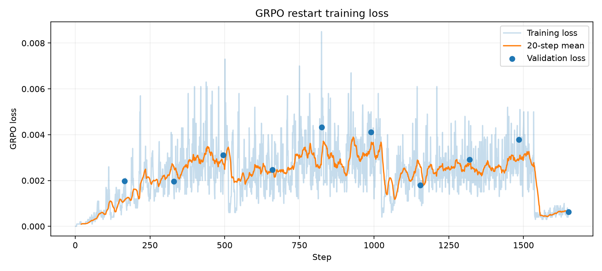

# MiniOneRec-Lite 正式复现报告

正式 GRPO 训练和测试已完成；SFT 对照测试已完成。按用户要求，本报告不统计实际收费；设备时间仍按日志如实记录。

## 目标与方法

在 Amazon Reviews 2018 Industrial 上复现 MiniOneRec 的商品语义 ID 和序列推荐流程。Qwen3-Embedding-4B 对完整商品目录生成向量，RQ-VAE 学习三层残差量化码本。Qwen2.5-0.5B Base 使用 LoRA 进行 SFT 和 GRPO，SFT 同时更新新增 SID token 行。GRPO 沿用固定的组内候选数量、约束 beam 和官方混合奖励，最终按官方 SID 匹配口径评估。论文基线与源码的差异已另行记录。[原始配置核对](original_config.md)

## 实验环境与数据

| 项目 | 已核验配置 |
| --- | --- |
| 服务器 | Ubuntu Linux x86_64，单张 PPU-ZW810，显存 96 GiB |
| 依赖 | Python 3.12.3，厂商 PyTorch 2.6.0 / CUDA 12.6，Transformers 4.57.1，TRL 0.24.0，PEFT 0.18.1，Accelerate 1.10.1，Datasets 4.2.0，PyArrow 21.0.0 |
| 模型 | Qwen3-Embedding-4B 与 Qwen2.5-0.5B Base，权重取自 Qwen ModelScope 仓库 |
| 数据 | 7,694 位用户，3,686 个目录商品，36,259 / 4,532 / 4,533 条训练、验证和测试序列 |
| 配置差异 | 单卡 PPU、Base 模型、LoRA、编码批大小 4。论文表 4 的商品数少一项，三组样本数相同。 |

正式服务器的依赖清单见 [pip freeze](server-pip-freeze.txt)；它记录实际环境，不替代仓库的 NVIDIA 环境锁文件。清单中部分包指向服务器 /tmp 的厂商 wheel，不能在其他机器直接 pip install；需重新取得兼容驱动和厂商安装包。

小规模 PPU 检查验证了 FP16 商品编码、BF16 SFT 和 GRPO、检查点重载、约束解码和指标计算。正式训练采用完整数据。[数据核验](local_validation.md)

## 已完成阶段与成本

| 阶段 | 耗时 | 卡时 | 峰值设备显存 |
| --- | ---: | ---: | ---: |
| 本地数据预处理 | 7.19 秒 | 0 | 无 |
| 正式商品编码 | 127.86 秒 | 0.03552 PPU-hours | 10,055 MiB |
| RQ-VAE 量化训练 | 4,277.30 秒 | 1.18814 PPU-hours | 851 MiB |
| SID 生成 | 23.64 秒 | 0.00657 PPU-hours | 265 MiB |
| 数据转换 | 2.36 秒 | 0 | 无 |

正式编码产出形状为 3,686 × 2,560 的 float32 矩阵，逐项核查为有限值。首次模型源连接失败的尝试额外占用 230.96 秒，列为重试开销。当前阶段记录采用设备占用时间乘以卡数计算卡时，显存按每秒采样。实际费用需与服务器账单核对。

## 量化结果与后续训练

RQ-VAE 完成全部 10,000 轮。按官方策略从碰撞率最低的检查点生成 3,686 项 SID，其中 3,675 个唯一 SID，最终碰撞率为 0.2984%，最大碰撞组为两个商品。训练曲线与原始日志一并归档。

首次 SFT 从第 1 步开始产生非有限梯度，终止后记录为失败尝试，耗时 2,905.80 秒，占用 0.80717 PPU-hours，峰值显存 12,512 MiB。使用实际 Qwen 权重和四条正式训练样本复现故障，同一批数据中 BF16 SDPA 输出非有限值，BF16 eager attention 损失 13.9362，所有梯度均有限。正式 SFT 从原始基座重新启动，SFT、GRPO 和评估统一使用 eager attention，训练遇到非有限损失或梯度即停止。训练超参数与数据规模按原计划执行。

## 训练曲线

SFT 验证 loss 从 epoch 0.5 的 2.726 降至 epoch 10 的 1.515。GRPO 验证 reward 在 0.00114–0.00117 附近波动；其 loss 含 KL 惩罚，受参考模型同步影响，不可直接解释为推荐效果。

## 正式训练及推荐测试结果

SFT 完成 10 个 epoch 并导出合并模型。首次 GRPO 使用学习率 1e-5、beta 0.001，在第一个 epoch 后按用户要求停止；随后从 SFT 权重重新初始化 LoRA，使用学习率 5e-6、beta 0.005、组大小 16、梯度裁剪 0.3 完成 2 个 epoch、1,650 步。参考模型每 512 步同步，因此 loss 和 KL 受到同步影响，不宜仅根据 loss 判断推荐质量。完整日志、检查点及中断尝试均保留在服务器。

最终约束解码测试集 4,533 条，每条 50 个候选，独立审计发现 0 个非法候选、0 个重复候选。目录中 3,686 个商品对应 3,675 个唯一 SID，指标依官方 SID 匹配计算，存在共享 SID 的局限。

| 模型（论文报告值除外均为本次实测） | HR@5 | NDCG@5 | HR@10 | NDCG@10 |
| --- | ---: | ---: | ---: | ---: |
| MiniOneRec-Lite SFT | 0.10986 | 0.08749 | 0.13898 | 0.09684 |
| MiniOneRec-Lite GRPO | 0.10765 | 0.08434 | 0.13677 | 0.09374 |
| MiniOneRec 论文 | 0.1321 | 0.1084 | 0.1586 | 0.1167 |
| TIGER 论文 | 0.1010 | 0.0807 | 0.1321 | 0.0908 |
| BIGRec 论文 | 0.1092 | 0.0907 | 0.1370 | 0.0997 |
| S-DPO 论文 | 0.1238 | 0.0991 | 0.1524 | 0.1082 |

NDCG@10 论文效果保留率为 0.09373954 / 0.1167 = **80.33%**。这不是严格受控对比：基座大小、Base/Instruct、LoRA、设备和目录 SID 碰撞情况等不同；论文基线是引用值而非本项目复现。其他论文基线参见 [配置对照](original_config.md)。SFT 与 GRPO 使用相同测试集、候选约束和指标；GRPO 相对 SFT 的 HR@10 下降 0.00221，NDCG@10 下降 0.00310（约 3.20% 相对下降）。这一单次运行未显示 GRPO 带来提升，不应概括为统计显著结论。SFT 审计同样无非法或重复候选。

## 训练及评估资源

| 阶段 / 尝试 | 设备时间（PPU-hours） | 采样峰值显存（MiB） | 状态 |
| --- | ---: | ---: | --- |
| 商品编码成功 | 0.03552 | 10,055 | 完成 |
| RQ-VAE | 1.18814 | 851 | 完成 |
| SID 索引 | 0.00657 | 265 | 完成 |
| SFT 首次尝试 | 0.80717 | 12,512 | 中断重试 |
| SFT 完整训练 | 11.63551 | 12,620 | 完成 |
| GRPO 原配置 | 9.50860 | 27,348 | 用户要求中止 |
| GRPO 一轮权重续训尝试 | 0.02095 | 20,666 | 用户要求中止 |
| GRPO 从 SFT 重启 | 16.90800 | 27,348 | 完成 |
| GRPO 测试推理 | 0.16642 | 1,722 | 完成 |
| SFT 对照测试推理 | 0.16545 | 1,722 | 完成 |

上述已记录成功主路径合计约 **29.94 PPU-hours**；连同已记录的失败 / 中断尝试及首次编码失败约 **40.34 PPU-hours**，不含未被计时脚本记录的准备、合并模型；计入 SFT 对照评测后，已记录的全部尝试合计约 **40.51 PPU-hours**。设备时间按单卡进程墙钟计算，不是实际 GPU 利用率积分；显存为采样峰值。服务器类型 PPU-ZW810 不应直接与论文 GPU-hours 当作等价算力比较。按用户要求不统计实际收费；计费时长未提供，不将设备时间推算为账单。论文未提供可直接核实的完整训练成本，不作节省比例声明。

## 结论与证据

完整链路已在单卡上运行，最终 GRPO 的测试表现低于 SFT 基线；该结果不支持声称 GRPO 改善了推荐效果。训练完成不意味着严格复现论文：模型规模、微调方式、SID 碰撞和官方实现与论文奖励细节差异均影响可比性。两组测试预测已各自重新执行独立审计并通过；本地汇总见 [GRPO 审计](../outputs/results/grpo_test_audit.json)、[SFT 审计](../outputs/results/sft_test_audit.json) 和 [阶段计时](../outputs/results/stages.jsonl)。逐条预测和最终 GRPO trainer state 已复制至本地 outputs/results；SFT 和 GRPO 最终检查点已备份至本地工作区 MiniOneRec/checkpoints，两个目录各 20 个文件均通过与服务器 SHA-256 对照；主要训练、量化和评测日志亦已备份到本地工作区 MiniOneRec，服务器保留完整原始产物，实际收费按用户要求不再追踪。
