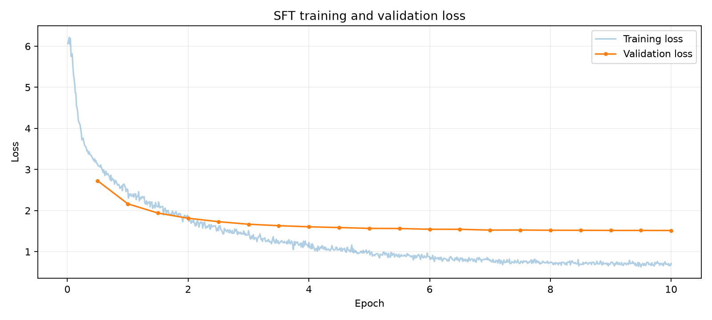
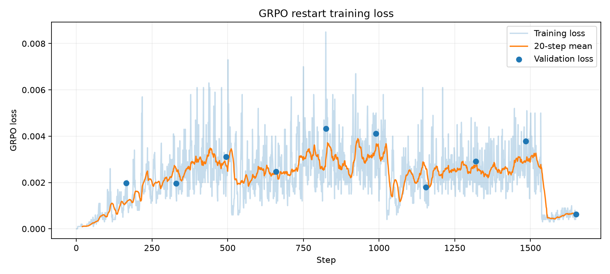

# MiniOneRec-Lite 实验讲解说明书

## 一、项目要解决什么问题

推荐系统通常需要根据用户的历史行为预测下一件可能感兴趣的商品。本项目以 MiniOneRec 论文和官方代码为基础，尝试用较小的语言模型和 LoRA，在单卡设备上跑通从原始商品数据到最终推荐指标的完整流程，并评估实际效果和设备时间。

核心问题是：能否把商品表示成语言模型可以生成的语义编号，让模型根据用户历史生成推荐结果？在受限算力下，这条路线的效果又能达到什么水平？

**实验结论先说：**完整链路已经跑通；最终 GRPO 模型的 HR@10 为 0.13677、NDCG@10 为 0.09374。但在同一测试协议下，SFT 模型的 NDCG@10 为 0.09684，本次 GRPO 未超过 SFT。GRPO 结果约为论文 MiniOneRec 报告 NDCG@10 的 80.33%，但两者配置不同，不能视为严格受控对比。

## 二、整体流程

```text
Amazon Industrial 原始数据
  ├─ 商品标题和描述 → Qwen3-Embedding-4B → 商品向量
  │                                      ↓
  │                                  RQ-VAE 量化 → Semantic ID
  └─ 用户交互记录 → 时间排序、构建历史序列 ──────────┘
                                      ↓
                       Qwen2.5-0.5B Base + LoRA SFT
                                      ↓
                         从 SFT 权重初始化 LoRA GRPO
                                      ↓
                         约束 beam search 生成候选
                                      ↓
                            HR@K / NDCG@K 测试
```

Semantic ID（SID）是商品的离散语义编码。模型预测的是 SID 序列，而不是直接输出数据库中的商品编号；约束解码利用商品目录限制可生成的前缀，确保输出对应目录内的合法 SID。

## 三、数据准备与划分

使用 Amazon Reviews 2018 的 Industrial and Scientific 类目，沿用官方实现的数据处理和滑窗构造方式，用户历史最多保留 10 个商品。按目标事件时间划分训练、验证和测试集，分别为 **36,259、4,532、4,533 条原始序列**，涉及 **7,694 位用户、3,686 件目录商品**。SFT 的不同任务形式可进一步扩展训练样本数，因此训练器显示的样本数不一定等于原始序列数。

训练仅使用训练交互，验证集用于训练过程检查，测试集用于最终评估。全商品目录及其元数据用于构建 SID 和约束候选。论文列出的商品数为 3,685，与实际处理得到的目录相差一件；本实验保留完整目录并记录差异。

## 四、商品语义编码和 SID 构建

首先使用 **Qwen3-Embedding-4B** 编码商品标题和描述，得到 **3,686 × 2,560** 的商品语义向量。随后按官方实现训练 **RQ-VAE**：通过多层残差量化逐级编码向量，得到三个离散码；模型训练了 10,000 轮，再使用官方碰撞处理策略生成最终 SID。

最终 3,686 件商品对应 3,675 个唯一 SID，碰撞率约 **0.2984%**，最大碰撞组包含两件商品。碰撞意味着不同商品可能共享一个 SID，因此测试指标反映的是官方 SID 等价口径，并非完全无歧义的商品级匹配。

## 五、SFT：让模型学会生成商品 SID

选择 **Qwen2.5-0.5B Base** 作为基座，用 rank 16 的 LoRA 微调，同时训练新增的 SID token embedding 行。模型学习根据用户历史和任务提示生成目标商品的 SID；训练结束后保存 adapter 和合并模型，供 GRPO 和评估使用。

正式 SFT 共 **10 个 epoch**。验证 loss 从第 0.5 个 epoch 的约 **2.726** 降至第 10 个 epoch 的约 **1.515**。这说明监督目标下的验证损失下降，但推荐性能仍需用最终 HR 和 NDCG 检查。



### 遇到的问题：非有限梯度

首次正式 SFT 出现非有限梯度。使用真实模型和少量正式样本进行复现后发现，在该服务器环境下 BF16 SDPA 路径出现非有限输出，而 BF16 eager attention 的损失和梯度有限。之后从原始基座重新启动训练，SFT、GRPO 和评估使用 eager attention，并在训练时检查非有限损失和梯度。该结论针对本次环境和复现样本，不宜推广为所有设备上的普遍结论。

## 六、GRPO：在组内候选之间优化

在已完成的 SFT 模型上重新初始化 LoRA，使用官方实现的约束 beam 和正确性、排序混合奖励。每个输入生成 16 个候选，在组内根据奖励计算相对优势，并加入相对参考模型的 KL 惩罚。训练中还记录奖励、KL、loss 和梯度范数。

第一次运行使用学习率 **1e-5**、KL 系数 **0.001**。第一轮结束前后的验证奖励基本持平，而 KL 上升，因此按实验过程中的决策停止原运行，重新从 SFT 模型开始，而不是沿用已训练的 GRPO adapter。

最终配置为：学习率 **5e-6**，KL 系数 **0.005**，组大小 **16**，梯度裁剪阈值 **0.3**；训练 **2 个 epoch、1,650 步**。由于学习率和 KL 系数同时改变，这次结果不能单独归因于某一个参数。



GRPO 的 loss 包含 KL 惩罚项，且参考模型每 512 步同步一次。同步可能使参考模型更接近当前模型，从而使 KL 和 loss 下降；因此不能像监督学习一样把 loss 下降直接解释为推荐质量提升。实际验证奖励整体在约 0.00114–0.00117 之间波动，最终需要看推荐评测。

## 七、如何评估推荐效果

对测试集的每条样本，使用合法 SID 前缀约束的 beam search 生成 50 个候选，再计算：

- **HR@K**：真实目标是否出现在前 K 个候选中，最后对测试样本取平均。
- **NDCG@K**：同样考察前 K 个候选是否命中，但越靠前的命中得分越高。

两个模型均在同一 4,533 条测试样本、同一候选约束和指标协议下评估。独立审计均发现 **0 个非法候选、0 个重复候选**，并复算了指标。

| 模型 | HR@5 | NDCG@5 | HR@10 | NDCG@10 |
| --- | ---: | ---: | ---: | ---: |
| 本项目 SFT | 0.10986 | 0.08749 | 0.13898 | 0.09684 |
| 本项目 SFT + GRPO | 0.10765 | 0.08434 | 0.13677 | 0.09374 |
| 论文 MiniOneRec 报告值 | 0.1321 | 0.1084 | 0.1586 | 0.1167 |

本次 GRPO 相比 SFT，HR@10 下降约 **0.00221**，NDCG@10 下降约 **0.00310**，即 NDCG@10 相对下降约 **3.20%**。这是一次运行的对照，不能据此声称差异有统计显著性，也不能泛化为 GRPO 一定无效。

论文效果保留率按 NDCG@10 计算：0.09373954 ÷ 0.1167 ≈ **80.33%**。论文采用的模型配置与本实验的模型大小、Base/Instruct、LoRA 方案及 SID 情况不同。论文结果是引用值，不是本项目重新训练得到的结果。论文与官方源码的奖励归一化细节也有差异，本实验采用官方入口实现。

## 八、计算资源

所有正式阶段使用单张 **PPU-ZW810（96 GiB）**。以下设备时间依据进程墙钟记录计算，显存为采样峰值；设备时间不等同于 GPU 利用率积分，也不能直接与不同型号 GPU-hours 当作同等算力。

| 阶段 | 设备时间 | 采样峰值显存 |
| --- | ---: | ---: |
| 商品编码 | 0.036 PPU-hours | 10,055 MiB |
| RQ-VAE 训练 | 1.188 PPU-hours | 851 MiB |
| SID 生成 | 0.007 PPU-hours | 265 MiB |
| SFT 正式训练 | 11.636 PPU-hours | 12,620 MiB |
| GRPO 从 SFT 重启训练 | 16.908 PPU-hours | 27,348 MiB |
| GRPO 测试 | 0.166 PPU-hours | 1,722 MiB |
| SFT 对照测试 | 0.165 PPU-hours | 1,722 MiB |

成功主路径约 **29.94 PPU-hours**，不含额外的 SFT 对照测试；包含已记录失败、中断及两次测试的全部尝试约 **40.51 PPU-hours**，不含未计时的部分准备和模型合并。按用户要求，本报告不统计实际收费。

## 九、可以如何讲这个项目

**一分钟讲解：**

> 我复现了 MiniOneRec 的低成本生成式推荐流程：先用 Qwen3-Embedding 和 RQ-VAE 把商品转成离散语义 ID，再用 Qwen2.5-0.5B 的 LoRA SFT 和 GRPO，根据用户历史生成商品候选，最后通过约束解码和 HR/NDCG 评估。在单张 PPU 上跑通了完整链路，GRPO 的 NDCG@10 为 0.09374，约为论文报告值的 80.33%。同时我做了同协议 SFT 对照，发现 GRPO 略低于 SFT，因此如实保留负结果，并结合 KL、奖励、参考模型同步和设备日志分析原因。

**常见追问：**

1. **为什么用 SID？** 将商品转为离散 token 序列，使语言模型可以按序列生成商品表示；同时需要处理编码碰撞和合法候选约束。
2. **为什么 GRPO loss 下降不代表效果提升？** loss 包含 KL 惩罚，且参考模型会同步；应结合验证奖励和最终 HR/NDCG 判断。
3. **GRPO 为什么低于 SFT？** 当前证据只能确认这次运行的结果低于基线，可能涉及奖励稀疏、训练约束等，但没有通过受控消融确定原因。
4. **80.33% 是否代表严格复现？** 不是。它是本次指标与论文报告值的比值，模型规模、微调方式和其他实验条件不同。
5. **结果如何复核？** 项目中保存测试预测、目录和指标审计脚本；模型检查点与服务器文件已通过 SHA-256 对照。正式报告保留完整配置及局限。

## 十、证据与文件

完整配置、局限及设备时间见 [复现报告](reproduction_report.md) 和 [原论文配置对照](original_config.md)。汇总指标位于仓库 `results/`。
